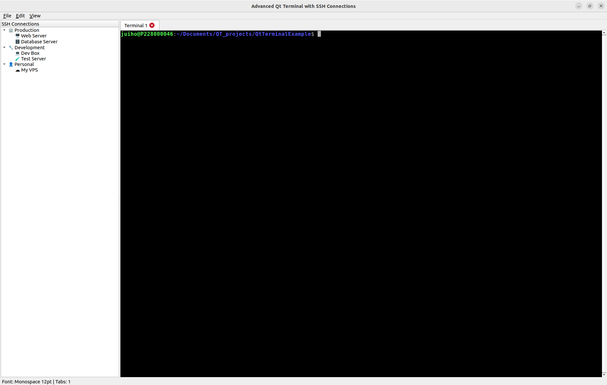

# Qt Terminal with SSH Connection Manager

A modern Qt-based terminal emulator with built-in SSH connection management, featuring a split-pane interface with connection tree, detailed connection panel, and multi-tab terminal area.



## Features

### ✅ Implemented Features
- **🖥️ Multi-tab Terminal Interface** - Full qtermwidget integration with tabbed terminals
- **🌳 Split-Pane SSH Connection Manager** - Three-panel layout with connection tree, details panel, and terminals
- **📋 Connection Details Panel** - Live connection information with quick-connect buttons
- **📁 Visual Connection Organization** - Folder structure with distinctive emoji icons
- **🔑 Password Authentication** - Secure password storage with show/hide toggle (optional)
- **🔐 SSH Key Authentication** - Per-connection private key file (`ssh -i`) and SSH agent support
- **🔌 One-Click SSH Connections** - Automatic SSH with password authentication using sshpass
- **🙈 Hidden Saved Passwords** - Saved passwords go to `sshpass -e` through the environment, never shown on screen, in shell history or in `ps`
- **📂 File Browser** - WinSCP-style SFTP browser docked beside the terminal: browse the server, drag files and folders down or up, edit remote files in your own editor, watch transfer progress
- **📡 SSH Host Scan** - Find hosts with SSH open in an IP range, with their MAC addresses, from this computer or through a saved connection, and import them as connections
- **📤 File Upload** - SCP upload from the SSH tab menu
- **🏠 Local Terminal Start Folder** - Local terminals open in your home folder, or a folder you pick with File → Start Folder...
- **💾 Persistent JSON Storage** - Automatic save/load of connections and settings
- **🔍 Connection Testing** - Ping-based connectivity testing before connecting
- **⌨️ Rich Keyboard Shortcuts** - Standard terminal shortcuts plus connection management
- **🔤 Font Management** - Customizable fonts with zoom controls (Ctrl++ / Ctrl+-)
- **🎨 Multiple Color Schemes** - Various terminal color themes
- **📊 Comprehensive Status Bar** - Font info, tab count, connection count, and activity status
- **🚀 Auto Host Key Management** - Automatic SSH host key acceptance for new connections
- **💡 Smart Connection Validation** - Input validation and error handling with helpful feedback

### 🚧 Planned Features
- **📈 Connection History** - Track and quick-access recent connections
- **🔍 Quick Connect Search** - Fast connection search and filtering
- **🎯 Import/Export** - Share connection configurations (JSON, CSV, other formats)
- **🔒 Password Encryption** - Secure encrypted password storage options

## Interface Layout

The application features a modern three-panel layout:

### Left Panel (Split Vertically)
- **Top: Connection Tree** - Hierarchical view of SSH connections organized by folders
- **Bottom: Connection Details** - Live details of selected connection with action buttons

### Right Panel
- **Multi-Tab Terminal Area** - Terminal tabs with close buttons and context menus

### Navigation Features
- **Resizable Splitters** - Drag to resize panels with visual grip handles
- **Collapsible Panels** - Minimize panels as needed (panels maintain minimum widths)
- **Context Menus** - Right-click anywhere for relevant actions

## Connection Management

### Connection Organization
Connections are organized into folders with distinctive icons:

- **🏢 Production** - Live servers and production environments
- **🔧 Development** - Development and staging servers  
- **👤 Personal** - Personal VPS and cloud instances
- **🧪 Testing** - Test servers and QA environments
- **🚀 Staging** - Pre-production staging environments
- **📁 Custom** - User-defined folder names

### Connection Types
Connection types are automatically detected and iconized:
- **🖥️ Web Servers** - Web, WWW, HTTP servers
- **🗄️ Databases** - Database, DB, SQL servers  
- **💻 Development** - Dev boxes and development servers
- **🧪 Test Servers** - Testing and QA servers
- **☁️ Cloud/VPS** - Cloud instances and VPS servers

### Connection Details Panel
The bottom-left panel shows comprehensive connection information:
- **Connection Name** - Display name with folder context
- **Host Information** - Hostname/IP address and port
- **Authentication** - Username and password status (shows masked password if saved)
- **SSH Key** - Key file name and whether the SSH agent is used (or "Not used")
- **Quick Actions** - Connect, Edit, and Delete buttons
- **Real-time Updates** - Panel updates automatically when selecting different connections

## Password Authentication

### Password Security Features
- **Optional Storage** - Password field is completely optional
- **Show/Hide Toggle** - Connection dialog includes visibility toggle while typing
- **Status Indicators** - Connection tooltips and details panel show password status
- **Automatic Authentication** - Uses `sshpass` for seamless login when password is available
- **Password Kept Off Screen** - The password is handed to `sshpass -e` through the `SSHPASS` environment variable, so it never appears in the terminal, in shell history, or in the process list (`ps`); the local shell drops it once the SSH session ends

### Security Considerations
- **Local Storage** - Passwords stored in `~/.config/QtTerminalExample/connections.json`
- **Plain Text Warning** - Currently stored unencrypted (encryption planned)
- **File Permissions** - Ensure config directory has appropriate permissions (600/700)
- **Production Recommendation** - SSH keys preferred for production environments

### SSH Host Key Management
- **Automatic Acceptance** - Uses `-o StrictHostKeyChecking=accept-new` for new hosts
- **Known Hosts Integration** - New keys automatically added to `~/.ssh/known_hosts`
- **Security Balance** - Prevents hanging on first connections while maintaining security for changed keys
- **Manual Override** - Pre-populate known_hosts for maximum security if desired

## SSH Key Authentication

Open a connection with **Edit** (or create one with **New Connection**) and switch to the **🔑 SSH Key** tab in the Connection Details:

- **Use SSH key authentication** - Turns the key options on for this connection
- **Private key** - Browse for a private key file (defaults to `~/.ssh`); it is passed to `ssh` and `scp` as `-i`. Leave it empty to use the agent and ssh's default keys (`~/.ssh/id_*`)
- **Use SSH agent** - Lets ssh use keys loaded in `ssh-agent` (`SSH_AUTH_SOCK`). Unchecked, the agent is ignored (`-o IdentityAgent=none`) and only the chosen key file is offered (`-o IdentitiesOnly=yes`)
- **Check Key** - Shows the key's type and fingerprint (`ssh-keygen -l`)

The tab checks the key as you pick it and warns when the file is missing, is a `.pub` public key, or has permissions that OpenSSH would refuse (fix with `chmod 600`). It also shows whether an agent is running.

The key settings apply to terminals, SCP upload and the file browser. A saved password is still used as a fallback if the server does not accept the key (by `sshpass` in terminals, directly by the file browser). Settings are saved with the connection in `connections.json` (`useKeyAuth`, `identityFile`, `useAgent`); connections saved by older versions load with key authentication off.

To set up a key for a server:
```bash
ssh-keygen -t ed25519 -f ~/.ssh/id_ed25519
ssh-copy-id -i ~/.ssh/id_ed25519.pub user@hostname
ssh-add ~/.ssh/id_ed25519   # optional: load it into ssh-agent
```

## File Browser

The file browser is a WinSCP-style SFTP panel for the SSH tab you're looking at. Open it with **View → File Browser** (`Ctrl+Shift+B`) or right-click an SSH tab → **📂 File Browser...**. It docks on the right of the terminal; drag its title bar to move it to the left or bottom, or float it.

- **Remote folder (top)** - The server's files with size, modified time, permissions and owner. Double-click a folder (or press `Enter`) to open it, `Backspace` or the ↑ button to go up, or type a path and press `Enter`. Click a column to sort; folders stay on top.
- **Local folder (middle)** - Where downloads go. Drag files or folders from the remote list and drop them here, or onto a local subfolder. Double-click to move between local folders.
- **Upload** - Drag files or folders from the local list, or from your file manager, onto the remote list (or onto a remote subfolder). Or right-click the remote list → **Upload Files...** / **Upload Folder...**, or right-click local files → **Upload to <remote folder>**. Replacing a file on the server asks first when it's in the folder you're looking at; folders are merged.
- **View** - Select a remote file and press `F3`, or right-click → **View**. It opens a read-only copy in your editor; nothing goes back to the server.
- **Edit** - Select a remote file and press `F4`, or right-click → **Edit**. It opens in your editor, and every time you save there it's uploaded back to the server, like WinSCP. **Edit With...** sets the editor command (used by View too) (such as `gedit`, `kate`, `code` or `xterm -e vim`); left empty, the system's default application for the file type is used. The local copy is kept in a private temporary folder and deleted when the tab closes, so save before closing it.
- **Edit a local file** - Select a file in the local list and press `F4`, or right-click → **Edit** (or **Edit With...**). It opens directly in your editor; there's no copy and nothing is uploaded, so saving writes the local file itself.
- **Right-click** a remote file or folder for **Download to <local folder>**, **Download To...** (pick another folder), **Edit** and **Copy Path**. Double-clicking a remote file also downloads it.
- **Transfers (bottom)** - Each download (↓) and upload (↑) with its progress. Right-click to cancel one, or to copy the error of a failed one. Folders transfer with everything inside them. Items that can't be copied (unreadable files, pipes and other special files) are skipped and the rest still comes across; the row then says **N skipped** in amber, and hovering over it or double-clicking it lists each item and why. In a downloaded folder, symlinks are recreated as symlinks with the same target, like `cp -a`; in an uploaded folder, links to folders are skipped.

Each SSH tab gets its own browser, connected with the tab's saved login: SSH key file, ssh-agent and your default keys, then the password. It opens one connection for browsing and one for transfers, so you can keep browsing while a big file moves. Transfers are written as `name.part` and renamed when complete, so an interrupted one never leaves a cut-off file under the real name. A file replaced on the server keeps its permissions (and its owner, when logged in as root); a symlink stays a symlink, and a writable file in a folder you can't write to (say, in `/etc`) is written in place. A new server's host key is saved to `~/.ssh/known_hosts`, the same as `ssh -o StrictHostKeyChecking=accept-new`; a changed key is refused.

The file browser uses [libssh](https://www.libssh.org/) for SFTP.

## SSH Host Scan

Find the machines in an IP range that accept SSH, like mRemoteNG's Port Scan but for SSH only. Open it with **Connections → Scan for SSH Hosts...**, right-click a folder → **Scan for SSH Hosts into <folder>...**, or right-click a connection → **Scan for SSH Hosts from Here...**. It opens as a **🔍 SSH Scan** tab beside the terminal tabs, so the results stay put while you work in a terminal, and a scan keeps running when you switch tabs. Close the tab to stop a scan.

- **IP range** - Start and end IPv4 address, up to 4096 addresses (a /20). It starts out as the /24 around the scanning host.
- **SSH port and timeout** - The port to check (22 unless set) and how long to wait for each host.
- **Scan from** - **This computer**, or **Through** a saved connection: the scan then runs on that server (a head node or jump box) and finds the hosts only it can reach. It uses only standard Linux tools there: `ping`, a TCP check of the port (bash's `/dev/tcp` with `timeout`, or `nc`), and the ARP table in `/proc/net/arp`. Nothing is installed.
- **Results** - One row per host that answered a ping, has the port open, or is in the ARP table, with its **IP address**, **MAC address** and **SSH open**. MAC addresses come from the scanning host's ARP table, so they show only for hosts on its own subnet (and for the scanning host itself). Hosts with the port open start checked; hosts that already have a connection are marked **(saved)**. When the port isn't open, the SSH column says why: **No (refused)** means the host answered but nothing listens on the port, **No (timed out)** means no answer within the timeout (often a firewall dropping it; try a longer timeout), and **No (unreachable)** means the network reported the host unreachable. Hover over the value for the same explanation.
- **Errors** - If logging in to the scan-from connection fails, or the scan script fails or is cut off there, the tab says so in red with the exit status and the server's error output (for example, an account with no login shell). Hosts found before a failure stay listed.
- **Import** - Pick a folder and username and press **Import**. Each checked host becomes an SSH connection named after its IP address, using the scanned port. Hosts that already have a connection are skipped. Imported connections connect directly from this computer; going through the jump host isn't supported yet.

## Requirements

### System Requirements
- **Qt 5.12+** (Qt 6 is not supported; the build looks for Qt 5 only)
- **lxqt-build-tools 0.9+** and **Qt 5 Linguist tools**, needed to build the bundled qtermwidget
- **Linux/Unix** system (build verified on Ubuntu 24.04; lxqt-build-tools 0.9+ means Ubuntu 22.04+ or Debian 12+)
- **C++11** compatible compiler (GCC 7+ or Clang 7+)
- **CMake 3.10+**

qtermwidget is bundled in the `qtermwidget/` folder and built together with the app, so you don't need a system qtermwidget package.

### Runtime Dependencies  
- **OpenSSH client** - For SSH connections (`openssh-client` package)
- **libssh 0.9+** - For the file browser (`libssh-dev` to build, `libssh-4` at runtime)
- **sshpass** - For automatic password authentication (optional but recommended)
- **ping utility** - For connection testing (usually pre-installed)

## Installation

### Install System Dependencies

**Ubuntu/Debian:**
```bash
sudo apt update
sudo apt install build-essential cmake qtbase5-dev qttools5-dev lxqt-build-tools \
                 libssh-dev openssh-client sshpass iputils-ping
```

**Fedora/RHEL:**
```bash
sudo dnf install qt5-qtbase-devel qt5-linguist lxqt-build-tools gcc-c++ make cmake \
                 libssh-devel openssh-clients sshpass iputils
```

**Arch Linux:**
```bash
sudo pacman -S qt5-base qt5-tools lxqt-build-tools cmake libssh openssh sshpass iputils
```

### Build Application

```bash
git clone https://github.com/JuihoChen/QtTerminalExample.git
cd QtTerminalExample
mkdir build && cd build
cmake ..
make -j$(nproc)
```

The build must happen in a separate `build` folder; the bundled qtermwidget refuses in-source builds. The build also copies the terminal color schemes into `build/color-schemes/`, next to the program, so you don't need to run `make install`.

### Run Application
From the `build` folder:
```bash
./QtTerminalExample
```

### Desktop Shortcut (Optional)
Run this from the `build` folder after building. It adds "Qt Terminal SSH Manager" to your app menu with a network/server icon, so it stands apart from the regular terminal, and puts a launcher on your desktop:
```bash
BIN="$PWD/QtTerminalExample"
mkdir -p ~/.local/share/applications
cat > ~/.local/share/applications/qt-terminal.desktop << EOF
[Desktop Entry]
Name=Qt Terminal SSH Manager
Comment=Terminal with SSH Connection Management
Exec=$BIN
Path=$(dirname "$BIN")
Icon=network-server
Type=Application
Terminal=false
Categories=System;TerminalEmulator;
StartupWMClass=QtTerminal
EOF
chmod +x ~/.local/share/applications/qt-terminal.desktop
update-desktop-database ~/.local/share/applications 2>/dev/null

# Optional: desktop icon (GNOME/Ubuntu)
cp ~/.local/share/applications/qt-terminal.desktop ~/Desktop/
gio set ~/Desktop/qt-terminal.desktop metadata::trusted true 2>/dev/null
```

- Then search for "Qt Terminal" in the app menu. If the desktop icon shows a warning, right-click it and choose **Allow Launching**.
- `StartupWMClass=QtTerminal` matches the app's window class, so the dock groups the running window with the launcher instead of showing a second, generic icon. If you pinned an older launcher, unpin it and pin the app again from the menu.
- Other built-in icon names you can use instead of `network-server`: `network-workgroup`, `preferences-system-network`, `utilities-system-monitor`.
- If you move or rebuild the project in a different folder, run the commands again so `Exec` points at the new location.

## Usage Guide

### Terminal Operations
- **New Tab** - `Ctrl+T` or File → New Tab or right-click tab bar
- **Start Folder** - File → Start Folder... picks the folder new local terminals open in (default: your home folder; falls back to home if the folder is gone)
- **Close Tab** - `Ctrl+W` or click × on tab or right-click → Close Tab
- **Switch Tabs** - `Ctrl+PageUp/PageDown` or click tab headers
- **Copy** - `Ctrl+C` in terminal or right-click → Copy
- **Paste** - `Ctrl+V` in terminal or right-click → Paste
- **Select All** - `Ctrl+A` or right-click → Select All
- **Clear Terminal** - Right-click → Clear or `Ctrl+L`

### Font and Display
- **Increase Font** - `Ctrl++` or View → Zoom In
- **Decrease Font** - `Ctrl+-` or View → Zoom Out
- **Reset Font** - `Ctrl+0` or View → Reset Zoom
- **Font Dialog** - View → Font... for comprehensive font selection
- **Color Schemes** - View → Color Scheme to cycle through themes

### Connection Management
- **New Connection** - `Ctrl+N` or Connections → New Connection
- **Quick Connect** - Select connection → click "🔌 Quick Connect" button
- **Double-Click Connect** - Double-click any connection for instant SSH
- **Edit Connection** - Select connection → click "✏️ Edit" or right-click → Edit
- **Delete Connection** - Select connection → click "🗑️ Delete" or right-click → Delete
- **Test Connectivity** - Use "Test Connection" button in connection dialog
- **Add to Folder** - Right-click folder → "Add Connection to [Folder]"
- **Folder Kept** - New Connection starts in the folder selected in the tree, and Edit Connection keeps the connection's current folder

### File Transfer Operations
- **Browse, Download, Upload and Edit** - `Ctrl+Shift+B`, or right-click SSH tab → "📂 File Browser..." (see [File Browser](#file-browser))
- **Upload File** - Right-click SSH tab → "📤 Upload File to Server"

### Interface Management
- **Resize Panels** - Drag the splitter handles between panels
- **Connection Details** - Click any connection to see details in bottom-left panel
- **Refresh Connections** - `F5` or Connections → Refresh
- **Status Information** - Check status bar for font, tab count, and connection count

## Configuration

### Connection Storage
- **File Location** - `~/.config/QtTerminalExample/connections.json`
- **Format** - JSON with connection details, passwords, and organization
- **Backup Strategy** - Regularly backup your connections file
- **Auto-Recovery** - Application creates defaults if file is missing or corrupted

### Security Configuration
Secure your connection data:
```bash
# Set proper permissions on config directory
chmod 700 ~/.config/QtTerminalExample
chmod 600 ~/.config/QtTerminalExample/connections.json

# Backup connections securely
cp ~/.config/QtTerminalExample/connections.json ~/connections-backup.json.$(date +%Y%m%d)
```

### Application Settings
- **Qt Settings Storage** - Window geometry, fonts, UI preferences, and the local terminal start folder
- **Automatic Persistence** - Settings saved automatically on exit
- **Manual Reset** - Delete `~/.config/QtTerminalExample/` to reset all settings

## Advanced Features

### SSH Connection Options
All SSH connections use optimized settings:
- **Keep-Alive** - `ServerAliveInterval=60` and `ServerAliveCountMax=3`
- **Host Key Policy** - `StrictHostKeyChecking=accept-new` for new connections
- **SSH Key Options** - `-i <key>`, plus `-o IdentityAgent=none -o IdentitiesOnly=yes` when the agent is turned off
- **Hidden Password** - `sshpass -e` reads the saved password from `SSHPASS`, which the local shell unsets when ssh exits
- **Connection Timeout** - The file browser gives up on an unreachable server after 15 seconds
- **Multi-Port Support** - Custom SSH ports supported with validation

### Terminal Enhancements
- **Large History Buffer** - 200,000 line history per terminal
- **No Blink on New Tabs** - A new tab keeps the previous picture until its shell prompt is drawn (at most 500 ms)
- **Desktop Launch Ready** - Sets a default `TERM` when started from a desktop shortcut
- **Display Platform** - Runs on X11 (`xcb`) by default; set `QT_QPA_PLATFORM` (for example `QT_QPA_PLATFORM=wayland ./QtTerminalExample`) to use another
- **Smart Font Scaling** - Synchronized font changes across all terminals
- **Session Persistence** - Terminal state maintained during SSH reconnections
- **Tab Management** - Intelligent tab titling and close behavior

### Error Handling & Recovery
- **Connection Validation** - Pre-connection testing and validation
- **Friendly Error Messages** - User-friendly error descriptions with suggested fixes
- **Automatic Retries** - Built-in retry logic for temporary failures
- **Fallback Options** - Graceful degradation when optional tools unavailable

## Keyboard Shortcuts Reference

| Action | Shortcut | Context |
|--------|----------|---------|
| **File Operations** |  |  |
| New Tab | `Ctrl+T` | Global |
| Close Tab | `Ctrl+W` | Global |
| Quit Application | `Ctrl+Q` | Global |
| **Connection Management** |  |  |
| New Connection | `Ctrl+N` | Global |
| Refresh Connections | `F5` | Global |
| **Terminal Operations** |  |  |
| Copy | `Ctrl+C` | In Terminal |
| Paste | `Ctrl+V` | In Terminal |
| Select All | `Ctrl+A` | In Terminal |
| **View Controls** |  |  |
| Zoom In | `Ctrl++` | Global |
| Zoom Out | `Ctrl+-` | Global |
| Reset Zoom | `Ctrl+0` | Global |
| File Browser | `Ctrl+Shift+B` | Global |
| Open folder / download file | `Enter` | Remote file list |
| Parent folder | `Backspace` | Remote file list |
| View remote file | `F3` | Remote file list |
| Edit remote file | `F4` | Remote file list |
| Edit local file | `F4` | Local file list |

## Troubleshooting

### Installation Issues

**CMake can't find `lxqt-build-tools` or `Qt5LinguistTools`**
```bash
# Ubuntu/Debian - both are needed by the bundled qtermwidget
sudo apt install lxqt-build-tools qttools5-dev
```
lxqt-build-tools must be version 0.9 or newer. Ubuntu 20.04 ships an older one, so use Ubuntu 22.04+ or build lxqt-build-tools from source.

**CMake can't find `libssh`** (`The following required packages were not found: libssh>=0.9`)
```bash
sudo apt install libssh-dev       # Ubuntu/Debian
sudo dnf install libssh-devel     # Fedora/RHEL
brew install libssh pkg-config    # macOS
```

**CMake can't find `Qt5`**
```bash
sudo apt install qtbase5-dev
```
Qt 6 alone is not enough; the project builds against Qt 5.

**"Cannot find color-schemes in any location!" / terminal is black on white**

The `build/color-schemes/` folder next to the program is missing. Run `make` again to copy it, and start the program from the `build` folder (or through the desktop shortcut above).

### Runtime Issues

**"sshpass command not found" warning**
```bash
# Install sshpass for automatic password authentication
sudo apt install sshpass

# Without sshpass, manual password entry is required
# The application will show a warning but continue to function
```

**"Connection hangs on first SSH attempt"**
- This occurs when SSH encounters an unknown host key
- The application automatically handles this with `StrictHostKeyChecking=accept-new`
- For maximum security, manually verify host keys first:
```bash
ssh-keyscan -H hostname >> ~/.ssh/known_hosts
```

**"Permission denied" for connections.json**
```bash
# Fix file permissions
chmod 600 ~/.config/QtTerminalExample/connections.json
chmod 700 ~/.config/QtTerminalExample/
```

### Connection Problems

**"Authentication failed" with correct password**
- Server might have disabled password authentication
- Check server SSH config: `PasswordAuthentication yes`
- Try manual SSH connection to verify: `ssh user@host`
- Consider using SSH keys for better security

**"Host unreachable" errors**
- Verify network connectivity: `ping hostname`
- Check firewall settings on both client and server
- Ensure SSH service is running on server: `sudo systemctl status ssh`

**"File transfer fails"**
- Verify SCP access on server (usually enabled with SSH)
- Check file permissions on remote server
- Ensure sufficient disk space for transfers
- Try manual SCP to test: `scp file user@host:/path/`

## Development

### Project Structure
```
QtTerminalExample/
├── main.cpp                 # Application entry point with platform setup
├── terminalwindow.h/.cpp    # Main window with three-panel interface
├── terminalwindow_*.cpp     # Main window split by area: ui, menus, terminal, ssh,
│                            #   connections, appearance, filebrowser, filetransfer
├── connectiondialog.h/.cpp  # Connection add/edit dialog with password and SSH Key tabs
├── hostscantab.h/.cpp       # SSH host scan tab (direct or through a saved connection) and import
├── commandsafety.h          # Safe ssh/scp command building and the SSHPASS environment
├── sshconnection.h          # Connection data (host, login, password, key settings)
├── AboutDialog.h/.cpp       # About dialog with the app version
├── enhanced_qtermwidget.h/.cpp # Enhanced terminal widget with improved selection
├── filebrowserpane.h/.cpp   # File browser: remote list, local drop target, transfers
├── remotefilemodel.h/.cpp   # Remote folder listing model and sorting
├── sftpworker.h/.cpp        # libssh SFTP connection, run on a worker thread
├── CMakeLists.txt           # CMake build configuration
├── qtermwidget/             # Bundled qtermwidget library (built with the app)
└── README.md               # This comprehensive documentation
```

### Key Classes
- **TerminalWindow** - Main application window with split-pane interface
- **ConnectionDialog** - Add/edit connection dialog with validation
- **EnhancedQTermWidget** - Enhanced terminal widget with improved text selection
- **TerminalPositionManager** - Coordinate conversion for terminal interactions
- **SSHConnection** - Connection data structure with password support
- **GripSplitter/GripSplitterHandle** - Custom splitter with visual drag handles
- **FileBrowserPane** - One SSH tab's file browser, shown in the File Browser dock
- **SftpWorker** - libssh session (login, SFTP listing, downloads, uploads, running a command) living on its own thread
- **HostScanTab** - SSH host scan tab and import into a connection folder

### Code Features
- **Modern Qt Practices** - Uses Qt 5.12+ features and best practices
- **Memory Management** - Proper object ownership and cleanup
- **Error Handling** - Comprehensive error handling throughout
- **Validation** - Input validation and user feedback
- **Security Focus** - Safe command construction and password handling

## Version History

### v0.7 (Current)
- ✅ **File Browser** - WinSCP-style SFTP browser (libssh) with drag-and-drop downloads and uploads and a transfer list; replaces the Browse/Download dialogs
- ✅ **View and edit remote files** - `F3` opens a read-only copy; `F4` opens a remote file in your editor and uploads it on every save
- ✅ **Start Folder** - Local terminals start in your home folder; File > Start Folder... picks another
- ✅ **Hidden Saved Passwords** - Passwords reach `sshpass -e` through `SSHPASS`, so they never show in the terminal, shell history or `ps`
- ✅ **Display Platform** - `QT_QPA_PLATFORM` is honored; X11 stays the default
- ✅ **Folder Transfers** - Unreadable or special files are skipped (and listed) instead of stopping the whole folder; symlinks shown in the local list
- ✅ **SSH Host Scan** - Find hosts with SSH open (IP, MAC) from this computer or through a saved connection, and import them into a folder
- ✅ **Smooth New Tabs** - The terminal area no longer blinks blank when a new tab opens
- ✅ **Fixes** - Default `TERM` when launched from a desktop shortcut, connection folders kept in New/Edit Connection, file browser no longer hangs on "Connecting..." or asks for a key passphrase

### v0.6
- ✅ **SSH Key Authentication** - SSH Key tab with private key file selection, ssh-agent option and key checks

### v0.5
- ✅ **Split-Pane Interface** - Three-panel layout with connection tree, details panel, and terminals
- ✅ **Connection Details Panel** - Live connection information with quick-action buttons
- ✅ **Enhanced File Transfer** - Visual remote file browser with directory navigation
- ✅ **Improved Error Handling** - Comprehensive error messages and validation
- ✅ **Visual Splitters** - Custom grip handles for panel resizing
- ✅ **Tab Context Menus** - File transfer options in terminal tab menus

### v0.4
- ✅ **Password Support** - Complete password field implementation
- ✅ **sshpass Integration** - Automatic password authentication
- ✅ **Connection Testing** - Ping-based connectivity testing
- ✅ **Enhanced Security** - SSH host key management and validation

### v0.3
- ✅ **SSH Connections** - Full SSH terminal implementation
- ✅ **Connection Management** - Add/edit/delete dialogs
- ✅ **JSON Persistence** - Reliable connection storage

### v0.2
- ✅ **Connection Tree** - Folder-based organization with emoji icons
- ✅ **Basic UI** - Multi-tab terminal interface

### v0.1
- ✅ **Terminal Foundation** - Basic qtermwidget integration

## Security Best Practices

### Password Security
1. **File Permissions** - Secure your configuration directory:
   ```bash
   chmod 700 ~/.config/QtTerminalExample
   chmod 600 ~/.config/QtTerminalExample/connections.json
   ```

2. **SSH Keys Preferred** - For production environments:
   ```bash
   ssh-keygen -t ed25519
   ssh-copy-id user@hostname
   ```

3. **Regular Backups** - Backup connections with proper security:
   ```bash
   cp ~/.config/QtTerminalExample/connections.json ~/secure-backup/
   chmod 600 ~/secure-backup/connections.json
   ```

### Network Security
- **VPN Usage** - Use VPN for connections over untrusted networks
- **Key Rotation** - Regularly rotate SSH keys and passwords
- **Monitoring** - Monitor server logs for unauthorized access attempts
- **Firewall Rules** - Implement proper firewall rules on servers

## Feature Comparison

| Feature | Status | Description |
|---------|--------|-------------|
| **Core Functionality** |  |  |
| Multi-tab Terminal | ✅ Complete | Full qtermwidget integration with tabbed interface |
| Split-Pane Interface | ✅ Complete | Three-panel layout with resizable splitters |
| SSH Connections | ✅ Complete | One-click SSH with automatic authentication |
| Connection Tree | ✅ Complete | Hierarchical folder organization with emoji icons |
| **Connection Management** |  |  |
| Connection Details Panel | ✅ Complete | Live connection information with action buttons |
| Password Storage | ✅ Complete | Optional password field with show/hide toggle |
| Hidden Saved Passwords | ✅ Complete | `sshpass -e` via environment; never on screen, in history or `ps` |
| Connection Folders | ✅ Complete | New/Edit Connection keep the selected folder |
| Connection Testing | ✅ Complete | Ping-based connectivity validation |
| JSON Persistence | ✅ Complete | Automatic save/load with error recovery |
| **File Transfer** |  |  |
| File Browser (SFTP) | ✅ Complete | WinSCP-style dock: drag-and-drop downloads/uploads, folders, transfer list |
| View/Edit Remote Files | ✅ Complete | `F3` read-only view; `F4` edit, uploaded back on every save |
| SCP Upload | ✅ Complete | Upload a file from the SSH tab menu |
| Error Handling | ✅ Complete | Comprehensive error messages and recovery |
| **Advanced Features** |  |  |
| SSH Key Support | ✅ Complete | Per-connection key file (`ssh -i`) and SSH agent integration |
| Local Start Folder | ✅ Complete | Choose where local terminals open (File → Start Folder...) |
| Display Platform Choice | ✅ Complete | X11 by default, `QT_QPA_PLATFORM` overrides |
| Password Encryption | 🚧 Planned | Secure encrypted storage implementation |
| Connection History | 🚧 Planned | Recent connections and usage tracking |
| Import/Export | 🚧 Planned | Configuration sharing and migration tools |


## Acknowledgments

- **[Qt Framework](https://www.qt.io/)** - Cross-platform application framework
- **[qtermwidget](https://github.com/lxqt/qtermwidget)** - Terminal widget implementation
- **[mRemoteNG](https://mremoteng.org/)** - Inspiration for connection management UX
- **[sshpass](https://sourceforge.net/projects/sshpass/)** - Password automation for SSH
- **OpenSSH Community** - SSH protocol implementation and tools


## License

This project is licensed under the MIT License.

## Author

**Qt Terminal with SSH Connection Manager**  
*Modern terminal emulation with integrated SSH connection management*

Created with ❤️ for efficient Linux system administration and development workflows.

---

*Streamline your SSH workflow with visual connection management* 🚀